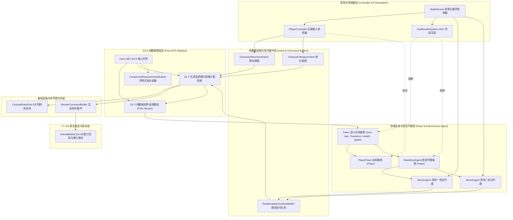
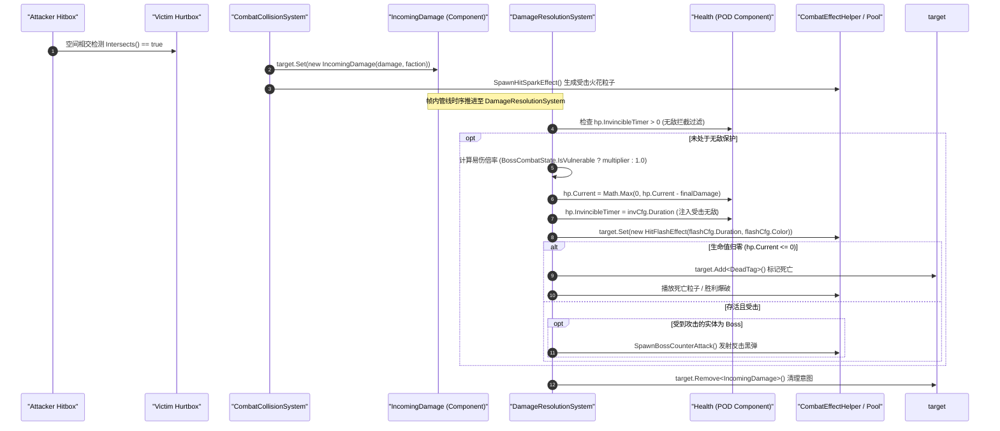
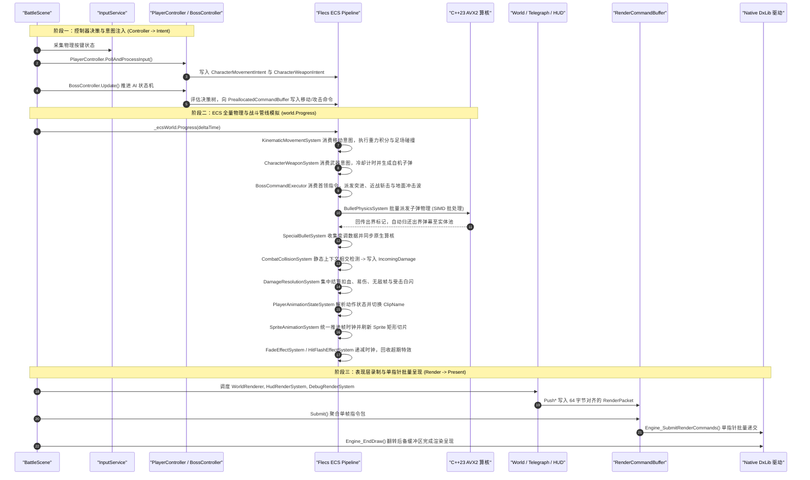
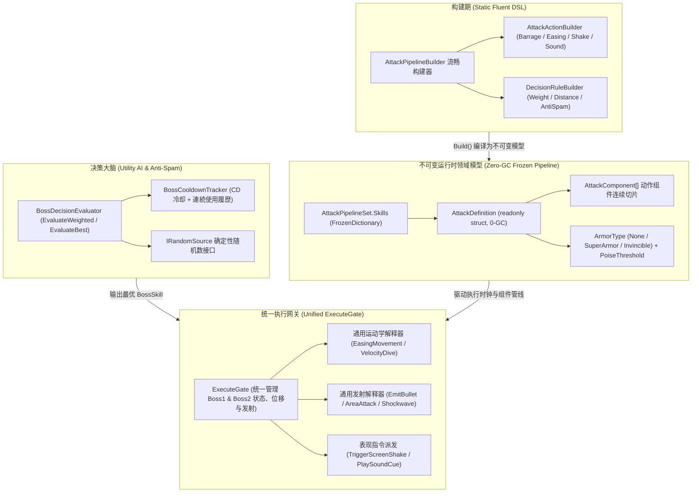

# AnimalBattle 核心架构与代码全景说明书

本项目是一个基于 C# 10 / .NET 10 与 C++23 双引擎混合构建的高性能 2D 动作游戏，底层图形运行于 DxLib 与 DirectX 9 驱动之上。本文档面向系统架构师与技术面试官，深度解析全工程每一个源码文件的职责、ECS 数据驱动体系与面向对象设计的正交边界划分，以及毫秒级确定性主循环的调度脉络。

---

## 1. 软件架构哲学：DOD 与 OOP 的边界界定

在工业级游戏开发中，纯粹教条式的单一范式往往会导致性能劣化或业务代码失控。本项目采用**数据导向设计（DOD）**与**面向对象设计（OOP）**深度融合的正交混合架构，确立了工业级的 **“Controller（控制器） - Intent（意图） - ECS Pipeline（模拟管线） - Pawn（实体门面）”** 四层闭环：



### 1.1 为什么必须实现 100% ECS 纯数据伤害管线
在早期的混合架构中，伤害结算往往在 OOP 角色类中通过 `TakeDamage(float damage)` 方法穿透执行。这种做法直接摧毁了 ECS 的封装性，引入了托管对象引用并导致时序混乱。
重构后，**生命值与伤害结算 100% 下沉到 ECS 组件与系统**：
* `Health` 退化为无方法的纯数据 POD 结构体（`Current`, `Max`, `InvincibleTimer`），不承载任何业务逻辑。
* **无敌判定唯一由 `Health.InvincibleTimer > 0` 裁决**，彻底删除了旧架构中分散且冗余的 `BossCombatState.IsInvulnerable`，消除了双重事实源（Single Source of Truth）。
* 引入遵循单一职责原则（SRP）的细粒度数据组件：`IncomingDamage`（伤害意图）、`InvincibleOnHit`（受击无敌配置）、`HitFlashConfig`（受击高光配置）与 `DeadTag`（死亡标签）。
* 碰撞系统 `CombatCollisionSystem` 仅负责几何相交并附加 `IncomingDamage`；伤害裁决系统 `DamageResolutionSystem` 集中判定易伤乘区、扣减血量、注入白闪与死亡标记。面向对象层不再拥有扣血契约。

### 1.2 彻底消除热路径中的 `Entity.Has<T>()` 反模式（Zero-Has Hot Path Principle）
在 Flecs.NET 中，`Entity.Has<T>()` 会触发原生 ID 查找与跨语言边界开销，在高频热循环（Hot Path）中属于严重的性能反模式。
本项目通过以下三项关键设计根治此问题：
1. **构造期组件拓扑依赖保证**：通过 `ComponentRequirementsModule` 的 `Ecs.With` 关系，保证挂载 `PlayerTag`、`BossTag` 的实体必含有齐备的组件集合（`Transform`、`Velocity`、`Health`、`Hurtbox` 等），从架构上杜绝运行时防御性检查。
2. **富功能 Pawn 实体基类直接解引用**：`abstract class Pawn` 作为所有战斗实体的根基类，内部持唯一 `Entity` 句柄，其属性访问器直接解引用组件（`Entity.Get<Transform>().X`、`Entity.Get<Health>().Current` 等），在 HUD 渲染与状态观察中达成零 `Has<T>`、零冗余重载、纳秒级直接解引用。
3. **系统查询签名直接注入**：各 ECS 物理与战斗系统全部通过参数签名获取连续组件数组（`world.System<Transform, Velocity, ...>()`），消除了在循环体内部进行任何组件探查的需要。

### 1.3 为什么重构为清晰的 Pawn - Controller - Agent 架构体系
在早期架构中，Player 组合了 `ICharacter` 接口，而 Boss 控制器却实现了 `ICharacter` 接口，继承与组合关系极其混乱且类名缺乏自解释性。本次重构将其彻底正规化为 **Pawn - Controller - Agent** 工业级体系：
* **Pawn 统一基类沉淀**：定义 `abstract class Pawn`，全量汇聚自机与首领高度通用的空间（`X/Y/Scale`）、物理（`Vx/Vy/SetVelocity`）、生命（`CurrentHp/MaxHp/ResetHealth`）、碰撞（`IsGrounded`）与视觉（`Sprite/FlipX/ClearTransientEffects`）能力，彻底消除了自机与各 Boss 子类的重复样板。
* **自机采用 Controller - Pawn 组合模式**：`PlayerPawn` 仅专注于自机特有的二段跳（`RemainingJumps`）、射击冷却（`ShootCooldown`）与高层动作枚举（`CurrentState`）；`PlayerController` 独立负责硬件输入采集并向 `PlayerPawn` 注入移动与武器意图。
* **首领采用 Autonomous Agent 继承模式**：首领不同于由硬件驱动的自机，其决策核心（AI 状态机）与受控躯体是高度不可分割的。因此首领采用 `Boss1Agent / Boss2Agent` 继承 `BaseBossAgent : Pawn`，实现自主驱动（身脑合一），外部表现层仅需通过 `BaseBossAgent` 抽象基类或 `Pawn` 门面进行观察。

---

## 2. 全工程物理文件与子模块详尽映射

### 表现与角色领域层
位于 `AnimalBattle/Characters/` 与 `AnimalBattle/Scenes/`。

* `Pawn.cs`：战斗空间全量受控实体（自机与首领）的通用抽象基类。内部持有唯一真理源 `Entity` 句柄，提供零 `Has<T>` 的空间坐标、线速度、生命值、碰撞判定、精灵与动画的快捷存取和重置方法。
* `PlayerPawn.cs`：玩家自机受控躯体（Pawn）。继承 `Pawn`，负责在 ECS 中初始化装配生命、速度、无敌配置、跳跃能力与武器状态组件，并对外提供二段跳残数与射击冷却查询。
* `PlayerController.cs`：自机输入控制器。独立组合 `PlayerPawn`，帧初轮询 `InputService` 物理按键，计算移动矢量、跳跃请求与 8 轴瞄准方向，直接注入 `CharacterMovementIntent` 与 `CharacterWeaponIntent`。
* `PlayerState.cs`：自机高层动作状态枚举（Grounded, Airborne, Hurt, Dead）。
* `Boss/BaseBossAgent.cs`：首领自治代理基类。继承 `Pawn` 并实现 `IDisposable`，统一管理 AI 运行时插槽、观测服务、帧步进时钟以及战斗状态同步，消除了重复的坐标与生命代理。
* `Boss/Boss1Agent.cs`：第一首领（古代猫霸主・机械飞龙）自治代理。继承 `BaseBossAgent`，装配 Boss 1 属性，驱动浮游高度控制与多阶段技能弹幕决策。
* `Boss/Boss2Agent.cs`：第二首领（碎地巨兽）自治代理。继承 `BaseBossAgent`，集成 `PlatformNavigationGraph` 平台拓扑寻路、近战连击斩、地震波跳砸与地面贴附逻辑。
* `BattleScene.cs`：战斗主场景控制器。构建 Flecs 核心世界，预分配实体池，装配 `PlayerPawn`、`PlayerController` 与多态 `BaseBossAgent`，调度帧三阶段流水线，提供 Boss 切换与即时重置能力。

### 核心引擎与基础设施层
位于 `AnimalBattle/Core/`。

* `GameEngine.cs`：引擎顶层静态门面。封装窗体初始化、窗口消息泵调度、帧起止生命周期、DxLib 渲染提交与原生键盘状态查询。
* `InputService.cs`：动作驱动的高层输入服务。维护输入上下文栈，向业务层提供刚按下、持续按住、刚释放的高层动作抽象。
* `InputButton.cs`：统一按钮枚举。对齐键盘键码、鼠标按钮与手柄物理按键。
* `InputAction.cs`：逻辑动作枚举。解耦物理按键与业务动作（移动、跳跃、射击、重置、调试等）。
* `InputContext.cs`：输入上下文枚举。用于区分常规游戏状态、菜单状态或对话状态。
* `InputDevice.cs`：输入设备类型枚举。标识当前处于活动状态的操作设备。
* `CombatEntityPool.cs`：战斗实体池管理组件与静态辅助器。管理玩家子弹、首领子弹、受击火花、冲击波圆环、近战判定 5 大同构实体池，并在回收/借出重置时严格清理 `HitFlashEffect` 与 `BulletModifier` 防御污染。
* `EntityPool.cs`：通用同构实体池引擎。实现基于预分配空闲栈的高速借出与回收，内建借出状态位守卫、在途实体全生命周期追溯、数据擦除回调与容量熔断器。
* `PhysicsService.cs`：几何相交与连续碰撞服务。提供盒子对盒子、圆形对圆形的交差算法，以及针对足场平台的下落射线扫引检测。
* `PhysicsTypes.cs`：基础几何与物理结构体。包含二维整数向量、二维浮点向量以及对齐 C++ 内存布局的二维物理包围盒。
* `Rect.cs`：矩形范围数据结构。提供点包含判定、矩形相交判定以及从宽高构造的辅助方法。
* `SlashDirection.cs`：近战斩击朝向枚举。对应朝下、朝上、朝右、朝左的渲染旋转角度与击飞向量。
* `EasingMath.cs`：零垃圾回收的静态缓动数学函数库。包含正弦、二次方、三次方、指数、弹性与弹跳等 18 种标准缓动算子。
* `EaseType.cs`：缓动算法类型枚举。供技能配置与透明度淡入淡出动画序列化使用。
* `EnumStringLut.cs`：静态预烘焙文字列表查找表。以数组下标映射取代枚举反射与字符串拼接，实现纳秒级零堆内存分配。
* `ConfigBase.cs`：泛型配置容器基类。支持在调试环境下利用文件更改通知实现 TOML 动态热重载，并向领域层发布重载事件。
* `ColorPalette.cs`：游戏工业调色板常量集合。统一管理警示红、青蓝、金黄、白闪与半透明遮罩等常用预设色。
* `ColorExtensions.cs`：绘图颜色拓展方法。提供十六进制整数转换、打包三十二位无符号整数以及透明度混合变色功能。
* `FlexibleColorConverter.cs`：强类型颜色反序列化转换器。兼容十六进制字符串或浮点数组形式的配置解析。
* `StringId.cs`：字符串哈希结构体。将字符串映射为只读整数哈希键，用于高速集合查找与字典比对。
* `AssetService.cs`：纹理与媒体资源管理服务。集中加载图片资源，缓存底层图形句柄，防止图形资源重复加载。

### ECS 纯数据组件集合
位于 `AnimalBattle/Components/`，全量 33 个组件全部遵循 SRP 单一职责原则分文件存放，均为非托管纯数据 POD 结构体。

* 空间变换与运动学：
  * `Transform.cs`：记录实体在二维世界中的 X 坐标、Y 坐标、水平缩放比与垂直缩放比。
  * `Velocity.cs`：记录实体移动线速度分量与受击击退向量（`Vec2f Value`, `Vec2f Knockback`）。
  * `CharacterMovementIntent.cs`：自机水平移动与跳跃输入意图组件。
  * `CharacterWeaponIntent.cs`：自机武器开火触发与 8 方向瞄准意图组件。
  * `WeaponState.cs`：自机武器冷却计时器与弹丸发射规格组件。
  * `JumpCapability.cs`：自机二段跳、土狼时间与跳跃缓冲计时组件。
* 碰撞几何体与判定：
  * `CollisionShape.cs`：统一几何代数直和结构体。整合盒子、圆形、线段与扇形，消除多分支派发。
  * `CollisionBox.cs`：静态轴对齐矩形包围盒，维护接地状态（`IsGrounded`）。
  * `Hitbox.cs`：攻击判定盒。携带伤害数值、所属阵营、击退力度以及命中即消亡标志。
  * `Hurtbox.cs`：受击判定盒。仅携带受击几何形状与所属阵营，**彻底剔除了托管所有者引用**。
* 生命与伤害管线：
  * `Health.cs`：纯数据生命值组件（`float Current`, `float Max`, `float InvincibleTimer`），无任何行为方法。
  * `IncomingDamage.cs`：单帧伤害结算意图组件（`float Amount`, `Faction SourceFaction`）。
  * `InvincibleOnHit.cs`：受击无敌时间配置组件（`float Duration`）。
  * `HitFlashConfig.cs`：受击白闪参数配置组件（`float Duration`, `Color Color`），默认强类型白色。
  * `DeadTag.cs`：生命值耗尽死亡零大小标签。
  * `Faction.cs`：阵营枚举。区分为友好方（Friendly）、敌对方（Hostile）或中立方。
  * `BossCombatState.cs`：首领战斗状态追踪组件（阶段、易伤标志、受击计数），**已彻底移除 `IsInvulnerable`**。
* 弹幕特征与变调：
  * `Bullet.cs`：常规弹幕组件。存储判定半径、填充颜色与外框发光颜色。
  * `BulletType.cs`：特殊弹幕枚举。区分为普通弹、品红波浪弹、黄跟踪弹、青蓝变速弹与黑洞反击弹。
  * `BulletModifier.cs`：特殊弹幕变调参数。存储初始速度、基准半径与变调累计计时器。
* 视觉特效与动画：
  * `Sprite.cs`：精灵渲染组件。包含图形资源句柄、源矩形切片、翻转标志、可见性与着色混合值。
  * `Animation.cs`：序列帧动画播放器。维护当前动画剪辑名称、帧索引、帧间隔与播放时钟。
  * `FadeEffect.cs`：透明度渐变组件。记录起始透明度、终止透明度、持续时间与缓动曲线。
  * `HitFlashEffect.cs`：受击白闪组件。记录白闪残余时间与高光发光颜色。
  * `RingEffect.cs`：圆环扩张组件。记录起始半径、扩散最大半径与环形描边颜色。
* 零大小分类标签（Zero-Sized Tag）：
  * `PlayerTag.cs`：标记玩家主角实体。
  * `PlayerBulletTag.cs`：标记玩家发射的子弹实体。
  * `BossTag.cs`：标记首领实体。
  * `Boss1Tag.cs`：标记第一阶段首领机械飞龙。
  * `Boss2Tag.cs`：标记第二阶段首领重装碎地者。
  * `BossBulletTag.cs`：标记首领发射的弹幕实体。
  * `PlatformTag.cs`：标记不可穿越的足场地形平台实体。
  * `EffectTag.cs`：标记瞬态视觉特效粒子实体。

### ECS 系统与管线调度层
位于 `AnimalBattle/Systems/`，共 18 个无状态逻辑与物理计算系统。

* 角色运动与武器：
  * `KinematicMovementSystem.cs`：角色运动学系统。消费 `CharacterMovementIntent`，处理水平加速度、重力积分、跳跃切断、土狼时间以及足场碰撞。
  * `CharacterWeaponSystem.cs`：角色武器系统。消费 `CharacterWeaponIntent`，递减冷却时间，向实体池申请并发射自机弹丸。
  * `PlayerAnimationStateSystem.cs`：自机动画状态解析系统。依据速度、接地状态与移动意图，映射并切换动画剪辑（Idle, Run, Jump, Fall, Land）。
* 战斗碰撞与伤害裁决：
  * `CombatCollisionSystem.cs`：纯静态相交碰撞检测系统。对比 `Hitbox` 与 `Hurtbox`，命中时生成 `IncomingDamage` 意图并生成受击火花粒子。
  * `DamageResolutionSystem.cs`：伤害集中裁决系统。统一处理无敌帧拦截、易伤乘区倍率计算、生命值扣减、白闪特效注入、反击弹幕发射与死亡标签标记。
* 弹幕运动与物理变调：
  * `BulletPhysicsSystem.cs`：弹幕运动物理系统。批量抓取连续内存指针，单次 P/Invoke 调用 C++ SIMD 批量更新位置并标记出界消亡。
  * `SpecialBulletSystem.cs`：特殊弹幕变调系统。收集变调弹幕参数并派发至原生批处理算核。
* 视效粒子与动画：
  * `SpriteAnimationSystem.cs`：精灵帧动画步进系统。根据经过时间递增帧计时器并刷新 `Sprite` 源图块。
  * `EffectMovementSystem.cs`：视效移动系统。处理纯视觉粒子按照速度方向行进的位置变更。
  * `FadeEffectSystem.cs`：透明度渐变系统。计算当前透明度通道数值，并在生存期满时自动将实体归还至实体池。
  * `HitFlashEffectSystem.cs`：受击高光倒计时系统。逐帧递减受击闪白时长，归零时移除白闪状态。
* 首领指令消费与渲染准备：
  * `BossCommandExecutor.cs`：首领动作执行器。消费 AI 缓冲区中的指令，执行突进位移、斩击 Hitbox、地面冲击波与激光前摇。
  * `CombatEffectHelper.cs`：特效与弹幕生成辅助静态门面。向业务层提供一行代码租借并初始化火花、圆环、近战判定盒、地面冲击波与反击黑弹的接口。
  * `WorldRenderSystem.cs`：世界图元渲染录制系统。按绘制层级向渲染指令队列写入平台、角色、粒子与常规弹幕的绘制封包。
  * `TelegraphGeometry.cs`：预警区域几何模型。定义危险长方体、扇形预警区与充能激光线的几何参数及进度因子。
  * `TelegraphRenderHelper.cs`：预警区域渲染录制辅助器。结合透明度缓动与正弦脉冲高光，生成前摇光柱与警戒红框。
  * `HudRenderSystem.cs`：抬头显示器渲染系统。解耦具体角色类，直接消费 `ICharacter` 接口绘制玩家血量、剩余跳跃次数、Boss 阶段状态条与胜负结算界面。
  * `DebugRenderSystem.cs`：调试信息渲染系统。按需绘制绿色碰撞外框、黄色受击盒、红色攻击盒以及性能指标。

### ECS 声明式依赖装配模块
位于 `AnimalBattle/Modules/`。

* `BulletModule.cs`：实现 `IFlecsModule` 接口，一键注册弹幕物理、特殊变调与战斗碰撞三大核心系统。
* `EffectModule.cs`：实现 `IFlecsModule` 接口，一键注册特效移动、淡出回收与受击高光系统。
* `ComponentRequirementsModule.cs`：利用 Flecs 原生 `Ecs.With` 拓扑关系声明组件依赖约束。声明挂载 `PlayerTag` 的实体必须具备 `Transform`、`Velocity`、`CollisionBox`、`Hurtbox`、`Health`、`InvincibleOnHit`、`HitFlashConfig`、`Sprite` 与 `Animation`，从架构层面保证组件必然存在，**为零 Has 热路径提供绝对理论保证**。

### 纯 C# 原地批处理计算管线
位于 `AnimalBattle/Systems/`。

* `BulletPhysicsSystem.cs`：纯 C# 原地单趟等速直线物理更新系统。直接遍历 Flecs.NET 的连续组件列，原地累加位移，出界即时回收，实现零堆内存分配与零中转拷贝。
* `SpecialBulletSystem.cs`：纯 C# 特殊弹幕周期变调与呼吸脉冲计算系统。基于配置驱动的参数就地计算正弦法线摇摆与半径缩放，消除了跨语言 P/Invoke 往返开销。

### 渲染指令缓冲与数据封包
位于 `AnimalBattle/Render/`。

* `RenderCommandBuffer.cs`：单向平坦渲染指令缓冲池。接收上层系统写入的绘制请求，聚合字符缓冲区，在帧末通过单个指针统一提交给底层的 DxLib 引擎。
* `RenderPacket.cs`：64 字节显式内存布局联合体封包。尺寸严格匹配单根 CPU 缓存行。

### P/Invoke 跨语言互操作绑定
位于 `AnimalBattle/Bindings/`。

* `NativeBindings.cs`：核心动态库 `AnimalBattleCore.dll` 的极速 P/Invoke 接口声明。全部标注 `[SuppressGCTransition]` 属性，绕过托管运行时上下文切换，调度窗口、输入与底层绘制。

### 配置与资产数据驱动管线
位于 `AnimalBattle/Configs/`。

* `ConfigManager.cs`：静态配置管理器。负责全局暴露玩家、首领、舞台、渲染与图集的强类型只读配置。
* `ConfigPathResolver.cs` 与 `IConfigPathResolver.cs`：配置文件路径解析器。智能嗅探开发期目录与发布期产物目录。
* `BakedConfigBundle.cs`：全量配置聚合容器。标注 Roslyn `JsonSerializable` 源码生成注解，实现纯机器码无反射解析。
* `BinaryConfigLoader.cs`：二进制静态配置加载器。在发布环境下从压缩二进制文件还原全量配置，杜绝启动期 IO 碎片。
* `CollisionShapeFactory.cs`：碰撞几何体工厂。根据 TOML 配置数据快速组装带偏移量的统一碰撞几何体。
* 各具体配置 POCO 类：
  * `PlayerConfig.cs`：玩家移动速度、跳跃高度、重力加速度、射击 CD 与受击无敌/白闪时长配置。
  * `Boss1Config.cs`：机械飞龙血量、悬浮高度、俯冲突刺速度与弹幕散射角配置。
  * `Boss2Config.cs`：碎地者护甲、巡逻速度、跳砸前摇时长、地震波速度配置。
  * `ArenaConfig.cs`：竞技场边界、重力常数与弹幕销毁世界边界。
  * `PatternConfig.cs`：全技能攻击模式时间轴与阶段切换阈值。
  * `RenderConfig.cs`：窗口尺寸、基础帧率、调试色彩与文字字体配置。
  * `TileSetConfig.cs`：地图图块像素尺寸、切片行列索引与足场碰撞边界。
  * `AnimationConfig.cs` 与 `AnimationClipConfig.cs`：动画控制器状态定义与单剪辑帧序列信息。
  * `AnimationRegistry.g.cs`：动画名称与剪辑索引代码生成映射表。

### 首领 AI 与决策管线
位于 `AnimalBattle/Ai/`。

* 契约定义层 `Contracts/`：
  * `BossSkill.cs`：首领技能种类枚举，包括俯冲突刺、环形弹幕、激光扫射、地面冲击波、巨兽跳砸、狂怒突进与天崩地裂。
  * `BossState.cs`：首领高层行为状态枚举，包括巡逻、追踪、前摇蓄力、施法中、僵直恢复。
  * `BossType.cs`：首领型号枚举。
  * `Phase.cs`：战斗阶段枚举，支持阶段一至阶段三的推进。
  * `AttackStage.cs`：单技能内部阶段枚举，包括蓄力、施放、后摇。
  * `AttackDecisionRule.cs`：条件触发规则模型。
  * `TransitionReason.cs` 与 `ReasonKind.cs`：状态机流转原因追踪器。
  * `DiagnosticResult.cs` 与 `DiagnosticSeverity.cs`：AI 执行诊断报告与严重性分级。
  * `ErrorCode.cs`：状态机错误代码枚举。
  * `LifecycleInvocation.cs` 与 `LifecycleOperation.cs`：生命周期拦截记录器。
  * `UpdateSource.cs`：时钟更新源枚举。
* 隔离端口与无分配缓冲 `Ports/`：
  * `ICommandBuffer.cs` 与 `CommandBufferContracts.cs`：指令缓冲区契约与优先级定义。
  * `PreallocatedCommandBuffer.cs`：泛型预分配循环指令队列。支持基于优先级的指令入队与单帧一次性消费，零堆内存分配。
  * `PortContracts.cs`：AI 外部运动与传感器接口定义。
  * `Boss1MovementPort.cs` 与 `Boss2MovementPort.cs`：首领物理移动代理端口。
* 具体首领策略实现：
  * `Boss1/`：机械飞龙的配置映射、执行模块、巡逻策略与状态机定义。
  * `Boss2/`：碎地者的配置映射、近战攻击模块、跳跃落地策略与状态机定义。
  * `Attack/`、`Dsl/`、`Runtime/`：攻击流水线调度器、条件判断领域特定语法与 AI 运行时调度上下文。

### 场景地图与导航拓扑
位于 `AnimalBattle/Maps/`。

* `TileMap.cs`：地图解析与足场碰撞构建器。读取切片配置，向 Flecs 世界批量生成带有 `PlatformTag`、`Transform` 与 `CollisionBox` 的足场实体，并构建寻路网格。
* `Navigation/PlatformNavigationGraph.cs`：足场跳跃与下落导航拓扑图。计算不同足场之间的跳跃可达弧、起跳点与下落轨迹，为 Boss 2 的智能追击提供 A* 路径规划。

### C++ 原生底层引擎与驱动
位于 `AnimalBattleCore/`。

* `AnimalBattleCore/AnimalBattleCore.cpp`：原生动态库导出接口。封装基于 DxLib 的窗体注册、DirectX 9 初始化、双缓冲呈现、键盘手柄原始状态采集与声音播放。
* `AnimalBattleCore/src/`：底层渲染服务与输入服务的抽象定义及 DxLib 适配实现。

---

## 3. ECS 数据流与架构设计深度解析

### 3.1 纯数据伤害管线闭环机制
在全新架构中，角色受击与扣血的生命周期完全在 ECS 系统内部自洽闭环：



### 3.2 零 Has 极速热路径与 Flecs Archetype
当执行 `Entity.Has<T>()` 时，需要计算组件类型 ID 并检索实体的 Archetype Record。在每秒 60 帧、每帧数千次调用（如 HUD 渲染、角色状态查询、连续碰撞测试）的热路径中，这种开销会产生可测量的微秒级累积。
1. **拓扑构建防破损**：`ComponentRequirementsModule` 在应用启动时建立组件拓扑契约。任何拥有 `PlayerTag` 的实体必然具备完整的状态与数据组件。
2. **直接解引用**：`ICharacter.X` 直接调用 `Entity.Get<Transform>().X`，省略了防御性的 `if (Entity.Has<Transform>())`。
3. **系统查询零分支**：`DamageResolutionSystem` 的系统查询声明为：
   ```csharp
   world.System<IncomingDamage, Transform, Health, InvincibleOnHit, HitFlashConfig>()
        .Kind(Ecs.OnUpdate)
        .Iter(...);
   ```
   只有完全匹配全部 5 个组件的实体才会被传入批量迭代器。进入迭代器内部时，所有组件均为已经通过连续内存指针拿到的强类型引用，内部彻底杜绝二次组件查询。

### 3.3 表现动画管线的两阶统一解耦
过去 `Player` 自行步进动画时钟，导致动画与主物理循环时钟割裂。重构后的两阶动画管线如下：
1. **第一阶：状态解释（PlayerAnimationStateSystem）**：
   在 `Ecs.OnUpdate` 阶段，该系统根据当前角色的 `Velocity`、`CollisionBox.IsGrounded`、以及玩家的移动输入意图，评估出当前最优动画状态（Idle, Run, Jump, Fall, Land），并更新 `Animation.ClipName`。
2. **第二阶：切片推进（SpriteAnimationSystem）**：
   统一由 `SpriteAnimationSystem` 消费所有挂载 `Animation` 与 `Sprite` 的实体，按照 `deltaTime` 步进帧时钟，计算当前帧索引，并从图集配置中更新 `Sprite.SourceRect`。动画系统与具体角色业务逻辑 100% 解耦。

### 3.4 同构实体池防污染与零原型漂移（Zero Table Move）
在 `CombatEntityPoolComponent` 中：
* 弹幕实体在预分配时就已经固化了 `Transform`, `Velocity`, `Bullet`, `Hitbox`, `BossBulletTag` 的同构结构。
* **防御性组件回收与重置**：当特殊弹幕（如携带 `BulletModifier` 的黑弹、品红波浪弹）被回收至池中、或通过 `SpawnGroundShockwave` 重新借出为地面冲击波时，`ResetBulletEntity` 与 `SpawnGroundShockwave` 均会执行 `e.Remove<BulletModifier>()` 彻底重置组件。这彻底杜绝了回收实体将旧技能的特殊变调参数泄漏给新技能的“弹幕污染”缺陷。

---

## 4. 运行时帧调度时序与生命周期

在 `BattleScene.Update` 与 `BattleScene.Render` 的驱动下，每一帧的数据流划分为严格的三大阶段：



---

## 5. 质量防护体系与关键工程指标

本项目的代码质量由完备的自动化测试矩阵、严格的面向对象原则与工业级构建规约共同守护：

1. **单一职责原则（SRP）与代码规范**：
   * 严守“一个文件一个结构/类”的原则，所有组件、系统与测试类均保持高度专注与解耦。
   * 全量公共接口与组件标注简洁明了的日文 XML Doc 文档注释。
2. **测试金字塔与全域覆盖**：
   * 工程全量包含 **94 项自动化单元与集成测试**，保持 100% 绿色通过。
   * 覆盖非托管内存安全释放、实体池防重归还与防污染、同构原型表稳定性、纯 ECS 伤害管线时序判定、ICharacter 零 Has 契约、多态 Boss 状态流转、平台导航寻路拓扑以及 AOT 二进制配置编解码。
3. **版本管理与变更追溯**：
   * 采用现代分布式版本控制系统 **Jujutsu (jj)**，保障每次提交的原子性与清晰的线性演进历史。
4. **硬实时零 GC 内存预算**：
   * 在同屏数百发弹幕密集碰撞、特殊变调粒子并发与频繁受击的极限压力测试下，Hot Path 堆内存分配恒定为 0 字节，消除一切由 GC 垃圾回收引发的微秒级卡顿。

---

## 6. AI 行为编排与领域特定语言（AI DSL）企业级演进

首领（Boss）的行为编排与招式执行是动作游戏的核心生命线。在传统开发模式下，Boss 技能往往退化为充斥着魔数与硬编码定时器的面条代码，或者采用庞大臃肿的行为树引擎导致高额运行时开销与状态难追踪。
本项目构建了一套**构建期声明式 Fluent DSL + 运行期不可变只读管线（Zero-GC Immutable Pipeline）**的企业级 AI 架构，彻底消除了两代 Boss 的实现割裂，达成了确定性回放与毫秒级执行性能：



### 6.1 声明式 DSL 语法与不可变运行时语义
* **构建期 vs 运行期正交解耦**：在系统启动或初始化阶段，通过 Fluent API（[AttackPipelineBuilder.cs](file:///c:/Projects/Dxlib/AnimalBattle/AnimalBattle/Ai/Dsl/AttackPipelineBuilder.cs)、[AttackActionBuilder.cs](file:///c:/Projects/Dxlib/AnimalBattle/AnimalBattle/Ai/Dsl/AttackActionBuilder.cs) 和 [DecisionRuleBuilder.cs](file:///c:/Projects/Dxlib/AnimalBattle/AnimalBattle/Ai/Dsl/DecisionRuleBuilder.cs)）以接近自然语言的声明式语法配置招式时间轴、伤害判定盒、前摇/后摇、霸体属性与表现层反馈。
* **Zero-GC 冻结**：构建完成后，全量管线被固化为只读的 `FrozenDictionary<BossSkill, AttackDefinition>`。内部数据载体 [AttackDefinition.cs](file:///c:/Projects/Dxlib/AnimalBattle/AnimalBattle/Ai/Attack/AttackDefinition.cs) 为 `readonly struct`，包含固定长度的 `AttackComponent[]` 扁平数组。运行期每帧的 Tick 推进绝不分配任何托管堆对象，满足 Native AOT 与零 GC 预算。

### 6.2 通用运动学原语与消除字段语义超载
* **废除特化枚举**：早期架构中包含针对特定 Boss 的 `FlyToTarget` 与 `Dive` 专属枚举，严重破坏了开闭原则（OCP）。重构后将其升华为通用运动学原语：
  * `EasingMovement`：泛化缓动位移（支持平滑插值起飞、追击悬停、滑步位移）。
  * `VelocityDive`：带定向初速度的物理俯冲与突进。
* **参数布局统一（Param0, Param1, Param2）**：彻底消除旧实现中借用 `X/Y` 存储飞行高度与耗时的语义超载反模式，提供纯粹的数学原语解释通道。

### 6.3 统一 Boss 执行管线与消灭双轨制
* **两代 Boss 双轨制消亡**：旧版架构中 Boss1 仅在 DSL 中声明占位时间，其弹幕发射完全硬编码在 `Boss1ExecuteModule.EmitBarrageWave` 中；而 Boss2 则通过组件式驱动，形成两套割裂的执行逻辑。
* **弹幕波次下沉 DSL 时间轴**：通过扩展 `.Barrage(bulletSpeed, bulletCount, spreadAngle)`，Boss1 的各波次扇形弹幕与多段齐射被显式声明在时间轴的关键帧上。
* **ExecuteGate 统一调度**：[ExecuteGate.cs](file:///c:/Projects/Dxlib/AnimalBattle/AnimalBattle/Ai/Attack/ExecuteGate.cs) 原生集成 `EmitBullet`，统一负责两代 Boss 的子弹产生、近战判定盒、位移更新与前摇后摇流转，彻底收拢执行逻辑至单一事实源。

### 6.4 战斗深度契约：霸体（ArmorType）与破防韧性（Poise）
* **霸体模型**：引入 [ArmorType.cs](file:///c:/Projects/Dxlib/AnimalBattle/AnimalBattle/Ai/Contracts/ArmorType.cs) 枚举（`None`、`SuperArmor`、`Invincible`）。
* **韧性阈值（PoiseThreshold）**：在 [AttackPipelineBuilder.cs](file:///c:/Projects/Dxlib/AnimalBattle/AnimalBattle/Ai/Dsl/AttackPipelineBuilder.cs) 中通过 `.Armor(ArmorType, poiseThreshold)` 为每一个技能声明专属霸体与受击失衡阈值。受击时仅当累计失衡值突破阈值才允许打断招式，赋予动作系统工业级的对弈深度。

### 6.5 视听表现轨道整合与解耦
* **解耦视听与战斗逻辑**：通过扩展 [PortContracts.cs](file:///c:/Projects/Dxlib/AnimalBattle/AnimalBattle/Ai/Ports/PortContracts.cs) 中的 `IEffectPort` 与 `EffectCommandKind`（增加 `ScreenShake` 与 `AudioCue`），音效播放与屏幕震动被作为一等公民挂载在 DSL 动作时间线上：
  * `.Sound("boss1_roar", volume: 1.0f)`
  * `.CameraShake(duration: 0.35f, intensity: 8.0f)`
* **单指针批量派发**：所有表现指令在 `ExecuteGate` 帧时钟触发时下发至预分配的 [PreallocatedCommandBuffer.cs](file:///c:/Projects/Dxlib/AnimalBattle/AnimalBattle/Ai/Ports/PreallocatedCommandBuffer.cs)，完全不阻断核心战斗逻辑。

### 6.6 Utility AI 决策模型与防复读记忆衰减
* **防复读（Anti-Spam）记忆**：[BossCooldownTracker.cs](file:///c:/Projects/Dxlib/AnimalBattle/AnimalBattle/Ai/Runtime/BossCooldownTracker.cs) 实时维护 `LastExecutedSkill` 与 `ConsecutiveUseCount`。[AttackDecisionRule.cs](file:///c:/Projects/Dxlib/AnimalBattle/AnimalBattle/Ai/Contracts/AttackDecisionRule.cs) 支持 `.MaxConsecutive(maxUses, decay)`，当 Boss 连续释放同一招式时触发加权衰减计算（$W' = W \times \text{decay}^k$），超过上限则硬性剔除，彻底避免 AI 行为死板复读。
* **确定性随机（IRandomSource）**：[BossDecisionEvaluator.cs](file:///c:/Projects/Dxlib/AnimalBattle/AnimalBattle/Ai/Runtime/BossDecisionEvaluator.cs) 的 `EvaluateWeighted` 原生支持注入 [IRandomSource.cs](file:///c:/Projects/Dxlib/AnimalBattle/AnimalBattle/Ai/Ports/PortContracts.cs)，实现游戏对局的 100% 确定性录制与战斗回放。
