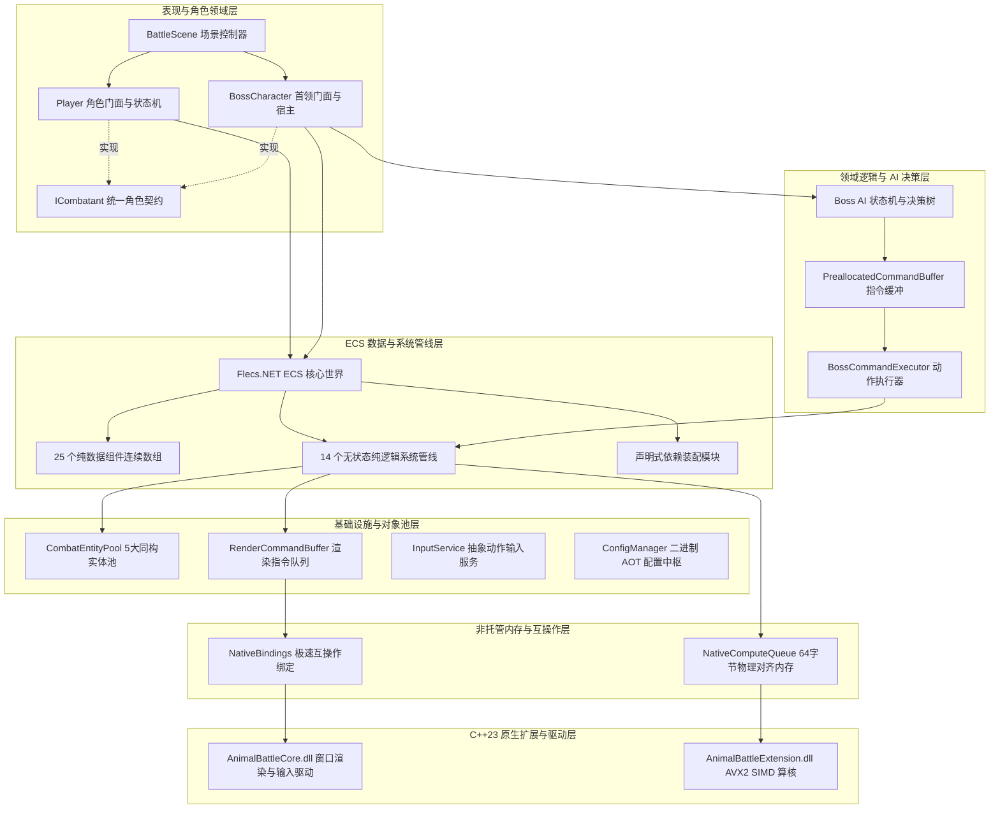
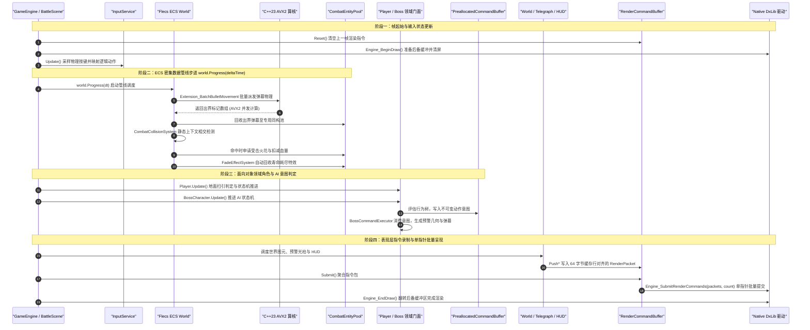

# AnimalBattle 核心架构与代码全景说明书

本项目是一个基于 C# 10 与 C++23 双引擎混合构建的高性能 2D 动作游戏，底层图形运行于 DxLib 与 DirectX 9 驱动之上。本文档面向系统架构师与技术面试官，深度解析全工程每一个源码文件的职责、ECS 数据驱动体系与面向对象设计的边界划分，以及毫秒级确定性主循环的调度脉络。

---

## 1. 软件架构哲学：DOD 与 OOP 的边界界定

在游戏工业级开发中，纯粹教条式的单一范式往往会导致性能劣化或代码失控。本项目采用数据导向设计（DOD）与面向对象设计（OOP）深度融合的正交混合架构：



### 为什么在 ECS 之上构建 OOP 角色门面
在纯 ECS 中，系统直接操作实体 ID 与裸组件，缺乏统一的领域聚合根，容易导致业务逻辑散乱在各个系统中。
本项目引入 `ICombatant` 接口，并由 `Player` 与 `BossCharacter` 充当领域门面类。门面类内部不存储任何坐标、生命值或速度私有字段，所有属性的读取与修改直接透传给底层 ECS 实体内部组件。
外部子系统（例如 HUD 渲染、伤害结算、胜负判定）通过强类型的面向对象接口与角色交互，而底层计算管线依然享受 ECS 数据在 CPU 缓存中的连续紧凑排布。

### 为什么 AI 决策与指令缓冲采用 OOP 模式
首领的攻击决策树与技能状态机属于高层复杂逻辑，其最大痛点在于与底层物理和渲染逻辑耦合，导致难以进行纯净的单元测试。
本项目将 AI 划分为面向对象的契约、端口与指令缓冲。AI 决策过程不直接修改任何 ECS 实体，仅将不可变的纯数据指令压入预分配的命令缓冲。这使得 AI 模块能够彻底脱离图形驱动与 ECS 容器，在纯内存环境下运行秒级单元测试。

---

## 2. 全工程物理文件与子模块详尽映射

以下为全工程所有物理文件按照架构分层的逐一职能映射。

### 表现与角色领域层
位于 `AnimalBattle/Characters/` 与 `AnimalBattle/Scenes/`。

* `ICombatant.cs`：统一战斗者抽象契约接口。规范了实体全局唯一标识符、二维世界坐标、二维线速度、当前生命值、最大生命值、所属阵营、无敌状态以及统一扣血契约。
* `Player.cs`：玩家角色面向对象门面类。内部封装基于输入的轻量状态机（地面、滞空、受击、死亡），维护跳跃次数、土狼时间（Coyote Time）与跳跃缓冲倒计时，统一代理物理扫引检测并向对象池申请玩家子弹实体。
* `BossCharacter.cs`：首领角色面向对象门面类。封装首领状态机，维护阶段迁移时钟、霸体受击判定与 AI 运行宿主，驱动 Boss1 与 Boss2 的行为决策。
* `BattleScene.cs`：战斗主场景控制器。负责整个 Flecs 世界的构建、实体池预分配预热、瓷砖地图实例化、静态查询通道缓存以及场景销毁时的内存清空。

### 核心引擎与基础设施层
位于 `AnimalBattle/Core/`。

* `GameEngine.cs`：引擎顶层静态门面。封装底层窗体初始化、窗口消息泵调度、帧起止生命周期、DxLib 渲染提交与原生键盘状态查询。
* `InputService.cs`：动作驱动的高层输入服务。维护输入上下文栈，支持上下文推入弹出，向业务层提供按键刚按下、持续按住、刚释放的高层动作抽象。
* `InputButton.cs`：统一按钮枚举。对齐键盘键码、鼠标按钮与手柄物理按键。
* `InputAction.cs`：逻辑动作枚举。解耦物理按键与业务动作，包括移动、跳跃、普通攻击、暂停与调试控制。
* `InputContext.cs`：输入上下文枚举。用于区分常规游戏状态、菜单状态或对话状态。
* `InputDevice.cs`：输入设备类型枚举。标识当前处于活动状态的操作设备。
* `CombatEntityPool.cs`：战斗实体池管理组件与静态辅助器。管理玩家子弹、首领子弹、受击火花、冲击波圆环、近战判定 5 大同构实体池。
* `EntityPool.cs`：通用同构实体池引擎。实现基于预分配空闲栈的高速借出与回收，内建借出状态位守卫、在途实体全生命周期追溯、数据擦除委托回调以及容量上限熔断器。
* `PhysicsService.cs`：几何相交与连续碰撞服务。提供盒子对盒子、圆形对圆形的交差算法，以及针对地面高速下落的射线扫引检测。
* `PhysicsTypes.cs`：基础几何与物理结构体。包含二维整数向量、二维浮点向量以及对齐 C++ 内存布局的二维物理包围盒。
* `Rect.cs`：矩形范围数据结构。提供点包含判定、矩形相交判定以及从宽高构造的辅助方法。
* `SlashDirection.cs`：近战斩击朝向枚举。对应朝下、朝上、朝右、朝左的渲染旋转角度与击飞向量。
* `EasingMath.cs`：零垃圾回收的静态缓动数学函数库。包含正弦、二次方、三次方、指数、弹性与弹跳等 18 种标准缓动算子。
* `EaseType.cs`：缓动算法类型枚举。供技能配置与透明度淡入淡出动画序列化使用。
* `EnumStringLut.cs`：静态预烘焙文字列表查找表。以数组下标映射取代枚举反射与字符串拼接，实现纳秒级零堆内存分配。
* `ConfigBase.cs`：泛型配置容器基类。支持在调试环境下利用文件更改通知实现 TOML 动态热重载，并向领域层发布重载事件。
* `ColorPalette.cs`：游戏工业调色板常量集合。统一管理警示红、青蓝、金黄、白闪与半透明遮罩等常用预设色。
* `ColorExtensions.cs`：绘图颜色拓展方法。提供十六进制整数转换、打包三十二位无符号整数以及透明度混合变色功能。
* `FlexibleColorConverter.cs`：强类型颜色反序列化转换器。兼容十六进制字符串或浮点数组形式的配置解析。
* `StringId.cs`：字符串哈希结构体。将字符串映射为只读整数哈希键，用于高速集合查找与字典比对。
* `AssetService.cs`：纹理与媒体资源管理服务。集中加载图片资源，缓存底层图形句柄，防止图形资源重复加载。

### ECS 纯数据组件集合
位于 `AnimalBattle/Components/`，全量 25 个组件均为不包含堆引用的非托管纯数据结构体。

* 空间变换与速度：
  * `Transform.cs`：记录实体在二维世界中的 X 坐标、Y 坐标、水平缩放比与垂直缩放比。
  * `Velocity.cs`：记录实体在 X 轴与 Y 轴方向上的线速度分量。
* 碰撞几何体与判定：
  * `CollisionShape.cs`：统一几何代数直和结构体。整合盒子、圆形、线段与扇形，消除多分支派发。
  * `CollisionBox.cs`：静态轴对齐矩形包围盒，用于足场平台与角色基本身位。
  * `Hitbox.cs`：攻击判定盒。携带伤害数值、所属阵营、击退力度以及命中即消亡标志。
  * `Hurtbox.cs`：受击判定盒。携带受击几何体、所属阵营以及无敌帧过滤标志。
* 状态与数值：
  * `Health.cs`：生命值组件。记录当前生命值、最大生命值以及伤害吸收逻辑。
  * `Faction.cs`：阵营枚举。区分为友好方、敌对双方或中立方。
  * `BossCombatState.cs`：首领战斗专属计时组件。记录霸体倒计时、硬直倒计时与闪烁周期。
* 弹幕特征与变调：
  * `Bullet.cs`：常规弹幕组件。存储判定半径、填充颜色与外框发光颜色。
  * `BulletType.cs`：特殊弹幕枚举。区分为普通弹、品红波浪弹、黄跟踪弹、青蓝变速弹与黑洞反击弹。
  * `BulletModifier.cs`：特殊弹幕变调参数。存储初始速度、基准半径与变调累计计时器。
* 视觉特效与动画：
  * `Sprite.cs`：精灵渲染组件。包含图形资源句柄、源矩形切片、翻转标志、可见性与着色混合值。
  * `Animation.cs`：序列帧动画播放器。维护当前动画剪辑名称、帧索引、帧间隔与播放时钟。
  * `FadeEffect.cs`：透明度渐变组件。记录起始透明度、终止透明度、持续时间与缓动曲线。
  * `HitFlashEffect.cs`：受击白闪组件。记录白闪残余时间与高光发光颜色。
  * `RingEffect.cs`：圆环扩张组件。记录起始半径、扩散最大半径与环形描边颜色。
* 零大小分类标签（Zero-Sized Tag）：
  * `PlayerTag.cs`：标记玩家主角实体。
  * `PlayerBulletTag.cs`：标记玩家发射的子弹实体。
  * `BossTag.cs`：标记首领实体。
  * `Boss1Tag.cs`：标记第一阶段首领机械飞龙。
  * `Boss2Tag.cs`：标记第二阶段首领重装碎地者。
  * `BossBulletTag.cs`：标记首领发射的弹幕实体。
  * `PlatformTag.cs`：标记不可穿越的足场地形平台实体。
  * `EffectTag.cs`：标记瞬态视觉特效粒子实体。

### ECS 系统与管线调度层
位于 `AnimalBattle/Systems/`。

* `BulletPhysicsSystem.cs`：弹幕运动物理系统。批量抓取连续内存指针，单次 P/Invoke 调用 C++ SIMD 批量更新位置并标记出界消亡。
* `SpecialBulletSystem.cs`：特殊弹幕变调系统。收集变调弹幕参数并派发至原生批处理算核。
* `CombatCollisionSystem.cs`：受击碰撞检测系统。纯静态上下文遍历，无闭包捕获，完成受击扣血、白闪触发与火花粒子生成。
* `SpriteAnimationSystem.cs`：精灵帧动画更新系统。依据经过时间步进剪辑帧索引并刷新显示图块。
* `EffectMovementSystem.cs`：视效移动系统。处理纯视觉粒子按照速度方向行进的位置变更。
* `FadeEffectSystem.cs`：透明度渐变系统。计算当前透明度通道数值，并在生存期满时自动将实体归还至实体池。
* `HitFlashEffectSystem.cs`：受击高光倒计时系统。逐帧递减受击闪白时长，归零时移除白闪状态。
* `BossCommandExecutor.cs`：首领动作执行器。负责消费 AI 缓冲区中的指令，触发突进、跳砸、全屏散射与激光前摇。
* `CombatEffectHelper.cs`：特效与弹幕生成辅助静态门面。向业务层提供一行代码租借并初始化火花、圆环、近战判定盒的静态接口。
* `WorldRenderSystem.cs`：世界图元渲染录制系统。按绘制层级向渲染指令队列写入平台、角色、粒子与常规弹幕的绘制封包。
* `TelegraphGeometry.cs`：预警区域几何模型。定义危险长方体、扇形预警区与充能激光线的几何参数及进度因子。
* `TelegraphRenderHelper.cs`：预警区域渲染录制辅助器。结合透明度缓动与正弦脉冲高光，生成具有呼吸感的前摇光柱与警戒红框。
* `HudRenderSystem.cs`：抬头显示器渲染系统。绘制玩家血量槽、剩余跳跃次数、Boss 阶段状态条与胜负结算界面。
* `DebugRenderSystem.cs`：调试信息渲染系统。按需绘制绿色碰撞外框、黄色受击盒、红色攻击盒以及性能指标。

### ECS 声明式依赖装配模块
位于 `AnimalBattle/Modules/`。

* `BulletModule.cs`：实现 `IFlecsModule` 接口，一键注册弹幕物理、特殊变调与战斗碰撞三大核心系统。
* `EffectModule.cs`：实现 `IFlecsModule` 接口，一键注册特效移动、淡出回收与受击高光系统。
* `ComponentRequirementsModule.cs`：利用 Flecs 原生 `Ecs.With` 拓扑关系声明组件依赖约束。例如声明挂载 `PlayerTag` 的实体必须具备 `Transform`、`Velocity`、`CollisionBox`、`Health`、`Sprite` 与 `Animation`，彻底消除漏挂组件导致的空引用异常。

### 批量计算与非托管内存队列
位于 `AnimalBattle/Compute/`。

* `NativeComputeQueue.cs`：高吞吐非托管批处理计算队列。调用 `.NET 10` 的 `NativeMemory.AlignedAlloc` 在非托管堆上分配 64 字节缓存行对齐的物理内存，实现固定开销零拷贝的跨语言批量调度。
* `SpecialBulletBatchItem.cs`：非托管特殊弹幕数据包。精确按 32 字节结构体对齐，供 AVX2 向量寄存器并发写入。

### 渲染指令缓冲与数据封包
位于 `AnimalBattle/Render/`。

* `RenderCommandBuffer.cs`：单向平坦渲染指令缓冲池。负责接收上层系统写入的绘制请求，聚合字符缓冲区，在帧末通过单个指针统一提交给底层的 DxLib 引擎。
* `RenderPacket.cs`：64 字节显式内存布局联合体封包。涵盖包类型、绘制层级以及图形、线条、文字或着色状态参数，尺寸严格匹配单根 CPU 缓存行。

### P/Invoke 跨语言互操作绑定
位于 `AnimalBattle/Bindings/`。

* `NativeBindings.cs`：核心动态库 `AnimalBattleCore.dll` 的极速 P/Invoke 接口声明。全部标注 `[SuppressGCTransition]` 属性，绕过托管运行时上下文切换，调度窗口、输入与底层绘制。
* `NativeExtensionBindings.cs`：原生扩展库 `AnimalBattleExtension.dll` 的批处理接口声明。调度 OpenMP 与 SIMD 并发计算核。

### 配置与资产数据驱动管线
位于 `AnimalBattle/Configs/`。

* `ConfigManager.cs`：静态配置管理器。负责全局暴露玩家、首领、舞台、渲染与图集的强类型只读配置。
* `ConfigPathResolver.cs` 与 `IConfigPathResolver.cs`：配置文件路径解析器。智能嗅探开发期目录与发布期产物目录。
* `BakedConfigBundle.cs`：全量配置聚合容器。标注 Roslyn `JsonSerializable` 源码生成注解，实现纯机器码无反射解析。
* `BinaryConfigLoader.cs`：二进制静态配置加载器。在发布环境下从压缩二进制文件还原全量配置，杜绝启动期 IO 碎片。
* `CollisionShapeFactory.cs`：碰撞几何体工厂。根据 TOML 配置数据快速组装带偏移量的统一碰撞几何体。
* 各具体配置 POCO 类：
  * `PlayerConfig.cs`：玩家移动速度、跳跃高度、重力加速度、射击 CD 与尺寸配置。
  * `Boss1Config.cs`：机械飞龙血量、悬浮高度、俯冲突刺速度与弹幕散射角配置。
  * `Boss2Config.cs`：碎地者护甲、巡逻速度、跳砸前摇时长、地震波速度配置。
  * `ArenaConfig.cs`：竞技场边界、重力常数与弹幕销毁世界边界。
  * `PatternConfig.cs`：全技能攻击模式时间轴与阶段切换阈值。
  * `RenderConfig.cs`：窗口尺寸、基础帧率、调试色彩与文字字体配置。
  * `TileSetConfig.cs`：地图图块像素尺寸、切片行列索引与足场碰撞边界。
  * `AnimationConfig.cs` 与 `AnimationClipConfig.cs`：动画控制器状态定义与单剪辑帧序列信息。
  * `AnimationRegistry.g.cs`：动画名称与剪辑索引代码生成映射表。

### 首领 AI 与决策管线
位于 `AnimalBattle/Ai/`。

* 契约定义层 `Contracts/`：
  * `BossSkill.cs`：首领技能种类枚举，包括俯冲突刺、环形弹幕、激光扫射、地震砸地。
  * `BossState.cs`：首领高层行为状态枚举，包括巡逻、追踪、前摇蓄力、施法中、僵直恢复。
  * `BossType.cs`：首领型号枚举。
  * `Phase.cs`：战斗阶段枚举，支持阶段一至阶段三的狂暴推进。
  * `AttackStage.cs`：单技能内部阶段枚举，包括蓄力、施放、后摇。
  * `AttackDecisionRule.cs`：条件触发规则模型。
  * `TransitionReason.cs` 与 `ReasonKind.cs`：状态机流转原因追踪器，用于诊断非法状态跳转。
  * `DiagnosticResult.cs` 与 `DiagnosticSeverity.cs`：AI 执行诊断报告与严重性分级。
  * `ErrorCode.cs`：状态机错误代码枚举。
  * `LifecycleInvocation.cs` 与 `LifecycleOperation.cs`：生命周期拦截记录器。
  * `UpdateSource.cs`：时钟更新源枚举。
* 隔离端口与无分配缓冲 `Ports/`：
  * `ICommandBuffer.cs` 与 `CommandBufferContracts.cs`：指令缓冲区契约与优先级定义。
  * `PreallocatedCommandBuffer.cs`：泛型预分配循环指令队列。支持基于优先级的指令入队与单帧一次性消费，零堆内存分配。
  * `PortContracts.cs`：AI 外部运动与传感器接口定义。
  * `Boss1MovementPort.cs` 与 `Boss2MovementPort.cs`：首领物理移动代理端口。
* 具体首领策略实现：
  * `Boss1/`：机械飞龙的配置映射、执行模块、巡逻策略与状态机定义。
  * `Boss2/`：碎地者的配置映射、近战攻击模块、跳跃落地策略与状态机定义。
  * `Attack/`、`Dsl/`、`Runtime/`：攻击流水线调度器、条件判断领域特定语法与 AI 运行时调度上下文。

### 场景地图与地形构建
位于 `AnimalBattle/Maps/`。

* `TileMap.cs`：地图解析与足场碰撞构建器。读取切片配置，向 Flecs 世界批量生成带有 `PlatformTag`、`Transform` 与 `CollisionBox` 的足场实体，并执行图块批次拼接。

### C++ 原生底层引擎与算核
位于 `AnimalBattleCore/` 与 `AnimalBattleExtension/`。

* `AnimalBattleCore/AnimalBattleCore.cpp`：原生动态库导出接口。封装基于 DxLib 的窗体注册、DirectX 9 初始化、双缓冲呈现、键盘手柄原始状态采集与声音播放。
* `AnimalBattleCore/src/`：底层渲染服务与输入服务的抽象定义及 DxLib 适配实现。
* `AnimalBattleExtension/AnimalBattleExtension.cpp`：纯计算扩展库导出接口。提供异常安全屏障与 C 格式 ABI 导出。
* `AnimalBattleExtension/src/Physics/BatchPhysics.ixx`：弹幕并发物理算核。基于 C++23 模块构建，使用 `#pragma loop(ivdep)` 指令指导 MSVC 生成 AVX2 向量化机器码，并在 Linux/GCC 环境自动回退至 OpenMP 并行。
* `AnimalBattleExtension/src/Compute/BatchComputeProcessor.ixx` 与 `SpecialBulletMath.ixx`：特殊弹幕变调数学计算核。在原生层直接计算三角函数波形与向心速度扰动。

---

## 3. ECS 数据流与架构设计深度解析

### 为什么选择 Archetype-Based ECS
在面向对象设计中，一万发子弹意味着一万个包含虚函数表指针（vptr）的堆对象，其物理内存在托管堆中离散分布。CPU 访问下一个子弹时几乎必然引发 L1/L2 缓存缺失（Cache Miss）。
Flecs ECS 采用 Archetype 存储模型：具有完全相同组件类型的实体被集中紧凑地存储在同一个数据表（Table）中。
当 `BulletPhysicsSystem` 遍历弹幕时，内存表现为连续密闭的 `Transform` 数组与 `Velocity` 数组。CPU 硬件预取器（Hardware Prefetcher）能以最高效率将后续数据拉入缓存，使单核每秒能够轻松更新数十万次碰撞与位移。

### 声明式依赖注入与装配架构
为了规避组件漏挂导致的防御性空值校验，本项目使用 Flecs 的声明式模块：

```csharp
// ComponentRequirementsModule.cs
world.Component<PlayerTag>().Entity
     .Add(Ecs.With, world.Component<Transform>().Entity)
     .Add(Ecs.With, world.Component<Velocity>().Entity)
     .Add(Ecs.With, world.Component<CollisionBox>().Entity)
     .Add(Ecs.With, world.Component<Health>().Entity)
     .Add(Ecs.With, world.Component<Sprite>().Entity)
     .Add(Ecs.With, world.Component<Animation>().Entity);
```

当代码中执行 `world.Entity().Add<PlayerTag>()` 时，Flecs 引擎会在底层自动补全其余六个关联组件，在编译期与装配期建立起组件拓扑完整性。

### 同构实体池彻底消灭 Table Move
当开发者随意对实体执行 `.Add<T>()` 或 `.Remove<T>()` 时，Flecs 必须在底层将该实体从旧数据表逐字节拷贝至新数据表，这被称为原型漂移（Archetype Churn）。
本项目的 `CombatEntityPool` 为五种不同生命周期特点的战斗体分别创建独立的 `EntityPool`。
在池初始化时，实体就已挂载齐全所需的全部数据组件。借出与归还过程中，代码只使用引用覆写组件内部数值，**严禁改变组件类型结构**。这使得高频战斗期间 ECS 数据表迁移次数恒定为零。

---

## 4. 运行时帧调度时序与生命周期

在 `BattleScene.Update` 与 `BattleScene.Render` 的驱动下，每一帧的数据流向如下：



---

## 5. 质量防护体系与关键工程指标

本项目的代码质量由全套自动化测试矩阵与工业级编译规约共同守护：

1. **绝对零编译器警告**：全解决方案开启严格分析器，保持 0 警告与 0 错误。
2. **测试金字塔与全域覆盖**：工程包含 59 项自动化单元与集成测试，覆盖非托管内存安全释放、实体池防重归还与状态机幂等性、同构原型表稳定性、连续碰撞检测穿透防护、Boss 阶段状态流转以及 AOT 二进制配置解码。
3. **硬实时内存预算**：在同屏数千发弹幕碰撞与大量视效迸发的极端负载下，Hot Path 堆内存分配量恒定为 0 字节，杜绝 GC 带来的微秒级帧骤降。
